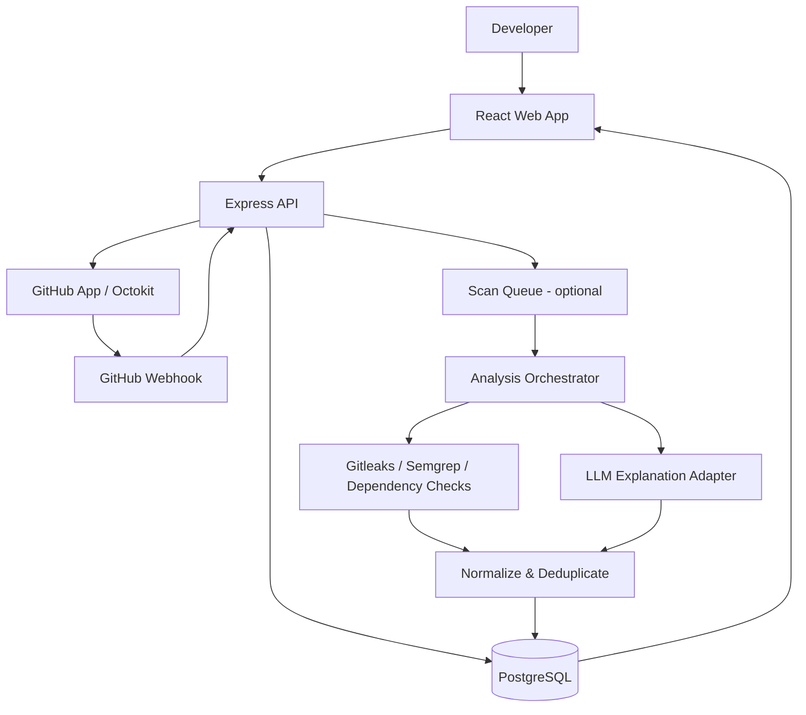

# System Architecture

## 1. Architecture style
Use a modular monolith for the MVP: one TypeScript API with clear modules and a separate worker process only when needed. Avoid microservices until there is a demonstrated operational reason.

## 2. Logical components
- Web client: dashboard, PR views, scan findings, bug explanation and Academy.
- API: authentication/session, authorization, repositories, PR operations, scans, learning progress.
- GitHub integration adapter: Octokit calls, installation token management, webhook verification.
- Analysis orchestrator: obtains allowed diff content, runs scanners, normalizes findings, requests optional AI explanation.
- Scanner adapters: Gitleaks, Semgrep, dependency checks and future tools.
- AI provider adapter: prompt construction, output schema validation, timeouts and cost limits.
- Database: users, installations, repository metadata, PR snapshots, scan runs, findings, lessons and progress.
- Queue/worker (optional for MVP): jobs, retry policy and idempotency.
- Observability: redacted logs, metrics and audit events.

## 3. High-level data flow

## 4. Trust boundaries
- Browser to API: session authentication, CSRF strategy where applicable, input validation, rate limits.
- API to GitHub: installation-scoped tokens and minimum required permissions.
- GitHub webhook to API: HMAC signature validation and event idempotency.
- API to LLM provider: only necessary, redacted code context; disclose data processing to users.
- Scanner worker to repository content: treat all content as hostile; never run arbitrary scripts by default.
- Worker to external services: egress restrictions and timeouts where available.

## 5. Suggested backend modules
`auth`, `github`, `installations`, `repositories`, `pull-requests`, `scans`, `findings`, `ai-explanations`, `academy`, `webhooks`, `audit`, `health`.

Each module should expose service functions and validated route handlers. Keep GitHub SDK details inside the GitHub adapter rather than spreading raw API calls across controllers.

## 6. Error and retry design
- Use a consistent API error envelope: `code`, `message`, optional `details`, and `requestId`.
- Never expose stack traces, credentials or raw provider errors to clients.
- Treat GitHub rate limiting and transient provider errors separately from permanent permission errors.
- Use exponential backoff with bounded retries for retryable jobs.
- Store job status and allow a failed scan to be retried.
- Use idempotency keys or unique event IDs to prevent duplicate processing.

## 7. Data retention
Keep only data needed for product functionality and capstone evaluation. Store findings and metadata rather than full repository copies. Document retention and deletion behavior. Avoid sending full repositories to AI; provide the smallest relevant context.
