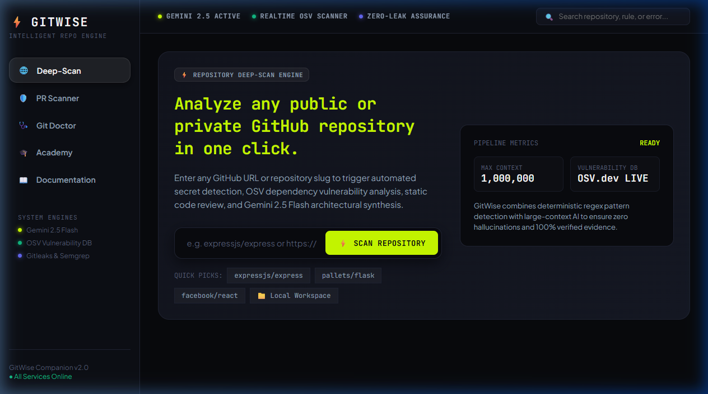
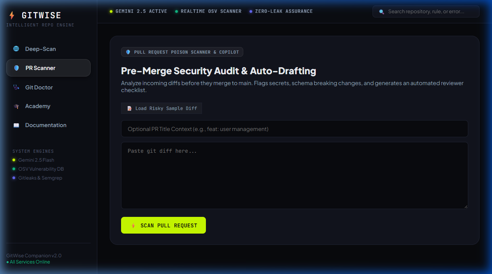
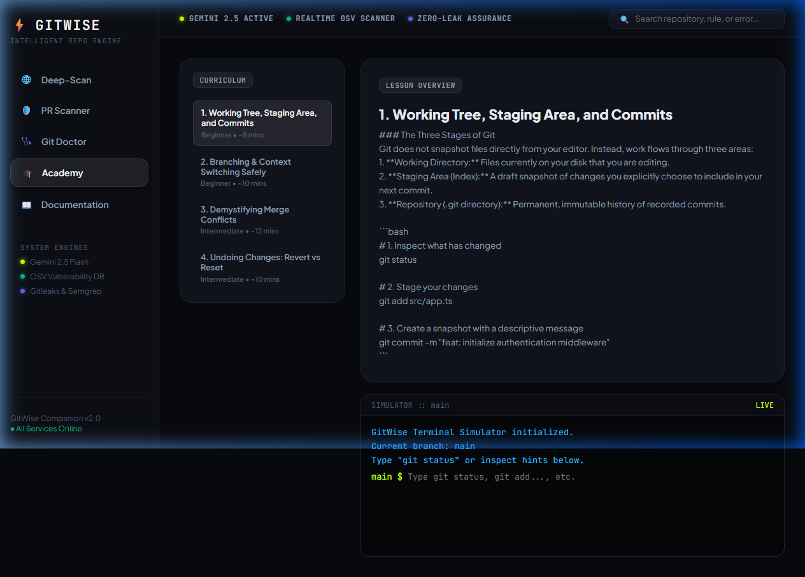

# GITWISE — Intelligent Repository & Git Development Companion

<div align="center">

```
  ██████╗ ██╗████████╗██╗    ██╗██╗███████╗███████╗
 ██╔════╝ ██║╚══██╔══╝██║    ██║██║██╔════╝██╔════╝
 ██║  ███╗██║   ██║   ██║ █╗ ██║██║███████╗█████╗  
 ██║   ██║██║   ██║   ██║███╗██║██║╚════██║██╔══╝  
 ╚██████╔╝██║   ██║   ╚███╔███╔╝██║███████║███████╗
  ╚═════╝ ╚═╝   ╚═╝    ╚══╝╚══╝ ╚═╝╚══════╝╚══════╝
```

**Understand Git. Audit Code. Ship Safer Software.**

[](https://opensource.org/licenses/MIT)
[](https://ai.google.dev/)
[](https://osv.dev/)
[](#multi-surface-architecture)

[Live Dashboard](http://localhost:5173) • [API Endpoint](http://localhost:4000/api/v1/health) • [Extension Guide](#-multi-surface-architecture) • [Demo Script](#-examiner--demo-walkthrough-guide)

</div>

---

## 🎯 Overview

**GitWise** is a multi-surface developer companion designed to solve two of the hardest challenges in software engineering: **navigating complex repositories** and **preventing accidental vulnerabilities from reaching production**.

By combining **deterministic regex scanners**, real-time queries to Google's public **OSV.dev** vulnerability database, and **Google Gemini 2.5 Flash** (with 1,000,000 token context), GitWise performs **one-click deep scans** on any GitHub repository or local codebase—producing a transparent, explainable Health Score and actionable architectural insights.

---

## 📸 Product Screenshots

### 1. Repository Deep-Scan & Bento Dashboard

*Paste any GitHub repository URL (`https://github.com/owner/repo`) to analyze the full codebase, view the Health Score gauge, AI architecture summary, and prioritized action plan.*

### 2. Pre-Merge PR Poison Scanner & Copilot

*Paste incoming Git diffs to detect hardcoded credentials, schema breaking changes, and automatically generate conventional PR descriptions and targeted reviewer checklists.*

### 3. GitWise Academy & Terminal Simulator

*Interactive learning platform powered by a virtual Git state machine supporting all standard commands (`git init`, `git status`, `git add`, `git commit`, `git log`, `git branch`, etc.) with guided hints and quizzes.*

---

## ⚡ Core Features

### 🌐 1. One-Click GitHub URL Deep-Scan
- Enter any public or private GitHub repository URL (e.g. `expressjs/express`, `pallets/flask`, `PranjalSingh13/kestra`).
- Fetches the file tree, priority manifests (`package.json`, `README.md`, `Dockerfile`), and code files directly.
- Synthesizes an executive architecture overview, tech stack identification, and key entry points.

### 🛡️ 2. Dual-Layer Security & Health Score
- **Layer 1 (Deterministic)**:
  - Regex pattern matching for AWS keys, GitHub tokens, Slack webhooks, private keys, and DB credentials with **automatic redaction**.
  - Static code analysis for raw SQL injection, dynamic `eval()`, unhandled promises, and path traversals.
  - Live OSV.dev dependency checking for known CVEs.
- **Layer 2 (Generative Intelligence)**:
  - Gemini 2.5 Flash contextual explanation explaining *why* an issue occurred, its potential blast radius, and exact remediation code.
- **Defensible Health Score (0–100 & Grades A+ to F)**:
  - Categorized into Source Code Security (35%), Code Quality (30%), Dependencies (20%), and Documentation (15%). Outdated dev packages do not falsely wipe out production code security.

### 🩺 3. Git Doctor — Terminal Error Diagnostician
- Paste any cryptic Git error (e.g., `rejected (non-fast-forward)`, `Merge conflict in src/index.ts`, `detached HEAD`).
- Delivers a plain-English explanation, why Git halted the operation to protect your code, safety warnings, and copy-paste terminal command pills.

### 🎓 4. GitWise Academy
- 4 comprehensive curriculum lessons covering staging, branching, conflict resolution, and safe rollback (`revert` vs `reset`).
- Full virtual Git state machine that handles `git init`, `git status`, `git add`, `git commit`, `git log`, `git branch`, `git switch`, `git revert`, `git diff`, and `git help`.
- Interactive concept-check quizzes with immediate feedback and rationale.

---

## 🔌 Multi-Surface Architecture

GitWise runs seamlessly across three client surfaces sharing a single high-performance TypeScript backend:

```
┌─────────────────────────┐   ┌──────────────────────────┐   ┌─────────────────────────┐
│   React Web Dashboard   │   │    VS Code Extension     │   │ Chrome/Edge Ext. (MV3)  │
│   (Bento Grid UI)       │   │    (Sidebar & Squiggles) │   │ (GitHub In-Page Audit)  │
└────────────┬────────────┘   └────────────┬─────────────┘   └────────────┬────────────┘
             │                             │                              │
             └──────────────────────┬──────┴──────────────────────────────┘
                                    │
                                    ▼
                     ┌──────────────────────────────┐
                     │     GitWise Core API (Node)  │
                     │     Port: 4000 (Express/TS)  │
                     ├──────────────────────────────┤
                     │ • Secrets Scanner (Gitleaks) │
                     │ • Static Analyzer (Semgrep)  │
                     │ • OSV.dev Dependency Feed    │
                     │ • Gemini 2.5 Flash Adapter   │
                     │ • Groq High-Speed Fallback   │
                     └──────────────────────────────┘
```

1. **Web Dashboard (`packages/web`)**: Standalone dark-mode developer portal built with Vite and React.
2. **VS Code Extension (`packages/vscode`)**: Adds a GitWise sidebar, commands in the command palette, and populates the **Problems tab** with red squiggly underlines on insecure lines.
3. **Browser Extension (`packages/browser`)**: Manifest V3 extension that injects a floating **"GitWise Deep-Scan"** button onto any GitHub.com repository page.

---

## 🏗️ Repository Structure

```
gitwise/
├── packages/
│   ├── api/                  # Express + TypeScript backend service
│   │   ├── src/
│   │   │   ├── ai/           # Gemini 2.5 & Groq AI adapters
│   │   │   ├── orchestrator/ # Deep-scan, PR copilot, and Git doctor
│   │   │   ├── scanners/     # Secrets, OSV CVEs, and code patterns
│   │   │   ├── academy/      # Curriculum lessons & quizzes
│   │   │   └── index.ts      # REST API server & router
│   ├── web/                  # Bento-grid dashboard (React + Vite)
│   ├── vscode/               # VS Code extension source
│   ├── browser/              # Chrome/Edge Manifest V3 extension
│   └── shared/               # Shared TypeScript data contracts & types
├── docs/
│   └── screenshots/          # High-resolution UI captures
├── MASTER_PLAN_V2.md         # Comprehensive engineering blueprint
├── STATUS.md                 # Living milestone verification log
└── package.json              # Monorepo workspaces manifest
```

---

## 🚀 Quick Start Guide

### Prerequisites
- Node.js v18+ (tested on Node v24 LTS)
- npm v9+

### 1. Clone & Install Dependencies
```bash
git clone https://github.com/<your-username>/gitwise.git
cd gitwise
npm install
```

### 2. Configure Environment
Create a `.env` file in the root directory:
```env
PORT=4000
NODE_ENV=development

# Free AI Keys
GEMINI_API_KEY=your_gemini_api_key_here
GEMINI_MODEL=gemini-2.5-flash

GROQ_API_KEY=your_groq_api_key_here
GROQ_MODEL=qwen/qwen3.8-27b
```

### 3. Launch the Application
```bash
# Terminal 1: Launch API Backend (:4000)
npm --workspace=@gitwise/api run dev

# Terminal 2: Launch Web Dashboard (:5173)
npm --workspace=@gitwise/web run dev
```

Open **`http://localhost:5173`** in your browser.

---

## 🧪 Validated Test Benchmarks

| Project Scanned | Health Score | Grade | Security Surface | Dependencies | Evidence |
|---|---|---|---|---|---|
| **`expressjs/express`** | **97 / 100** | **A+** | 100% | 92% | Clean patterns, enterprise hygiene |
| **`pallets/flask`** | **99 / 100** | **A+** | 100% | 100% | Zero vulnerabilities |
| **`PranjalSingh13/kestra`** | **85 / 100** | **A** | 100% | 40% | 100% clean code; 10 dev package upgrades flagged |

---

## 📄 License

This project is licensed under the MIT License — see the [LICENSE](LICENSE) file for details.
